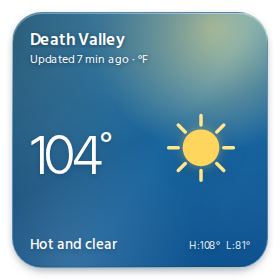
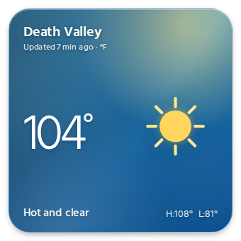
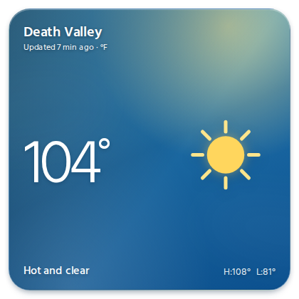

# Bundled Weather plan

## Status

Weather remains a proposed bundled artifact template. Rupert changed the data-source decision after the first implementation plan passed review, before implementation began. This revision returns the architecture and UI specs and their stories to independent spec review. The existing Weather proofs describe the superseded agent-written model and are intentionally left unchanged until the revised specs pass; implementation slices are withdrawn and will be derived again after the proofs are revised.

## Decisions Rupert made

1. **Open at 340 by 340 reference pixels.** This is now the decided default, with `transparent: true` retained in the draft. It is compact without making the three-character temperature treatment feel pinched.

   | 280 × 280 | **340 × 340 — selected** | 420 × 420 |
   | --- | --- | --- |
   |  |  |  |

2. **Fetch forecasts in the page from Open-Meteo.** The store now holds the place name, latitude, longitude, units, and an optional page-owned saved forecast. Agents no longer fetch or write forecast values.
3. **Use Open-Meteo's free API.** Rupert judged Television to qualify because it is free and MIT-licensed, with no subscriptions or advertising, matching Open-Meteo's examples of non-commercial use.
4. **Credit the data visibly.** Open-Meteo data are under CC BY 4.0, so every card state carries the provider and licence credit.
5. **Treat 10,000 calls per day per IP address as a release constraint.** The provider also lists 5,000 calls per hour and 600 per minute. The release gate below keeps the aggregate effect of many open copies visible.

## Decisions made in this draft

These choices were necessary to turn Rupert's direction into one exact contract. They are recommendations until Rupert accepts the revised specs.

1. **Keep a normalized, page-owned `forecast` cache.** It retains the already reviewed `timeZone`, `updatedAt`, `current`, `hourly`, and `daily` shape, plus the requested coordinates and units. That lets the offline page keep the accepted time-zone, window, label, and display rules without exposing Open-Meteo's parallel response arrays to agents.
2. **Match a cache by coordinates and units, not the display name.** A different coordinate or unit can produce a wrong display and is ignored. A place-name-only change safely reuses any compatible forecast and changes the label. The state-based request check still runs because a whole-root name change can also remove the saved forecast.
3. **Do not add geocoding.** The agent supplies the human-readable name and WGS84 coordinates together. The page calls only the forecast endpoint, so it does not guess which place a name means or add another provider, request, failure mode, or licence.
4. **Make one seven-day request.** The exact request asks for current, hourly, and daily temperature, WMO weather code, and day/night fields, with `timezone=auto`, `timeformat=unixtime`, the selected temperature unit, and `forecast_days=7`. The returned hourly series is ample for the first 23 future entries without a second request.
5. **Use UNIX instants for daylight-saving correctness.** Hourly values become ISO instants and are formatted in the returned IANA time zone. Open-Meteo fixes `utc_offset_seconds` at request time for the whole response and instructs clients to apply it to daily UNIX values. Daily cache entries use the date produced by that offset instead of passing a daily timestamp through the IANA zone. A live New York response spanning the 1 November 2026 clock change confirmed that rule.
6. **Timestamp receipt, not model generation.** `updatedAt` is the instant on the page clock after a complete response has been received and validated. The visible age says how long ago the shown forecast was fetched, whether it came from this page, another open page, or an earlier session.
7. **Keep `current` strict and tolerate bad forecast-list entries.** A response needs complete, valid current conditions. Within otherwise present hourly and daily arrays, the page drops an entry with a missing, null, non-finite, invalid, or unmapped value, then requires the normalized candidate to pass the cached-forecast schema and page checks. A malformed page-owned cache remains disposable: the page ignores it, fetches, and replaces it on the next successful save instead of making valid location settings unreadable. This lets an installed copy survive a later provider code or isolated gap without inventing the condition a person sees now.
8. **Map every documented forecast WMO code explicitly.** Codes 0, 1–2, 3, 45/48, the documented liquid-precipitation and frozen-precipitation codes, and 95, 96, 97, and 99 map to `clear`, `partly-cloudy`, `cloudy`, `fog`, `rain`, `snow`, and `thunderstorm`. Current summaries preserve useful distinctions such as mainly clear, drizzle, heavy rain, rime fog, snow grains, and hail while the artwork stays within the seven-condition vocabulary.
9. **Use one state-based request check without per-location history.** The page runs the check on every store value, about every minute while visible, and when it becomes visible. For the current coordinates and units, it requests only when no attempt is still running, no failed attempt began in the preceding 15 minutes, and no compatible saved or in-memory forecast was fetched in that period. A successful attempt leaves only its forecast, whose `updatedAt` supplies the freshness check; it does not remain as throttle history. The page tracks at most the running attempt and the latest failure while its coordinates and units stay current. An unanswered attempt is aborted after 10 seconds, attempts never overlap, and failures do not create a faster retry loop. Checking each minute produces refreshes about every 15 minutes and still lets one open page reuse a fresh forecast saved by another.

   In the units-switch example, the Fahrenheit success replaces the Celsius cache and in-memory forecast. Switching back to Celsius finds neither a compatible forecast nor a running or failed Celsius attempt, so it requests at once. In the clear-and-reset example, `{}` removes the saved forecast and clears the page's in-memory forecast and attempt state. Setting the same place again therefore also requests at once.

10. **Discard obsolete in-flight results.** A coordinate or unit change aborts an older attempt and clears a failure for the old values, so the state check can request for the new configuration at once when it has no fresh compatible forecast. A response for the old configuration is neither shown nor saved.
11. **Save by a root transaction.** An open page with write access preserves the current place and unknown fields, aborts when the coordinates or units changed, and replaces any earlier, invalid, or incompatible `forecast`. When two open pages race, the last transaction to commit supplies the saved forecast. This avoids comparing clocks from different devices while still preventing an old response from restoring a location an agent just changed.
12. **Prefer a non-future forecast.** A page may have both a saved forecast and one fetched into memory. It first prefers a candidate whose `updatedAt` is not in the future, then chooses the later candidate, so a clock set ahead cannot permanently displace new results. A successful result remains visible if its attempted save loses access or the Television connection.
13. **Fail softly when a cache exists.** A provider failure keeps the preferred compatible saved or in-memory forecast without an extra error label. Its unchanged age says when the shown forecast was fetched and avoids crowding the small card. With no compatible forecast, the page shows “Forecast unavailable” and says it will try again in about 15 minutes. While the page remains visible with the same coordinates and units, the state check makes the next attempt about 15 minutes after the failed attempt; new coordinates or units can make one sooner.
14. **Distinguish disconnection from revocation.** An ordinary Television disconnection does not stop in-memory refreshes after the page has read a location. Once `onAccessChanged(null)` reports revocation, the draft aborts a running Open-Meteo request, rejects any result that still arrives, stops new requests, and keeps the forecast already shown. Before the first store value arrives, either case leaves the page loading as before.
15. **Use a compact but complete attribution line.** The UI spec owns `Open-Meteo data · adapted · CC BY 4.0`, its two links, and the card states that carry it. “adapted” visibly records the condition mapping, selection, labels, and rounding required by CC BY 4.0.
16. **Change only the data-source-dependent placeholders.** Empty becomes “No location yet” because `{}` now means no configuration. Loading also covers a configured first fetch. A new unavailable story covers failure without a cache, and a saved-after-failure story shows the silent cached fallback. Minimum-size stories now bind both the empty and longest unreadable placeholders to the credit. The accepted appearance, condition, time-zone, accessibility, and layout designs remain.
17. **Keep default verification local and add one opt-in live boundary test.** Default browser tests intercept every Open-Meteo request, script its response from captured fixtures, delay it, or abort it, and fail any request without an expected method, URL, query, and disposition. Captured success fixtures include the returned CORS header; tests for malformed values edit copies of those responses. Outside CI, one opt-in test sends the exact request from a copied page in Television's sandboxed artifact frame, requires the live response to pass the page success rule, and can refresh those fixtures. It does not cover the desktop `Origin` and `Referer` path. The provider terms and rate limits, and the future availability of a compatible CORS response, also remain unproven.
18. **Keep only the hourly entries the card can use before its next refresh.** After filtering, ordering, and deduplicating the provider response, the draft cache retains at most 24 future hourly entries: the 23 cells the card can display plus one extra for an hour boundary before the next refresh. A compact representative cache measured 15,868 bytes with all 168 provider hours and 2,886 bytes with 24, reducing its hourly-heavy stored form from 15.5 KiB to 2.8 KiB. This is a draft recommendation for Rupert because it trades unused offline horizon for smaller whole-store reads and writes.
19. **Recommend town-level coordinates by default.** The future README asks agents to use only the precision the forecast needs because every configured page discloses the coordinates with the viewer's IP address to Open-Meteo. Finer coordinates remain valid when a person wants a more precise forecast.

## Design decisions carried forward

- The small, medium, and large layouts retain the 600-by-480 and 760-by-740 two-dimensional thresholds, the 230-pixel minimum treatment, and the wide-short composition.
- The hourly window begins with current conditions as “Now”; later cells and daily rows keep the accepted instant, time-zone, locale, deduplication, and current-date rules. Age, labels, windows, and current high and low follow the clock within one minute.
- The seven skies, first-party condition drawings, gradient-only backgrounds, white type, responsive temperature, range bars, transparent document, fixed placeholder sky, and theme treatment are unchanged.
- The page continues to use the foundation typography and spacing. The separate typography reading remains an open question below.
- The Toolbox icon remains first-party. The future package will still carry the Phosphor spinner and warning assets under the vendored-asset and folder-notices rules.

## What was verified

### Open-Meteo

- The official Forecast API endpoint is `https://api.open-meteo.com/v1/forecast`. Its documentation defines `latitude`, `longitude`, `current`, `hourly`, `daily`, `temperature_unit`, `timeformat`, `timezone`, and `forecast_days`, and documents the requested current, hourly, and daily fields.
- `timezone=auto` returns an IANA `timezone`; `timeformat=unixtime` returns epoch seconds. The documentation says `utc_offset_seconds` is resolved at request time and fixed throughout the response, including across daylight-saving changes. It instructs clients to apply that offset to reproduce provider dates and to convert hourly UNIX instants with the returned IANA zone for daylight-saving-aware local times.
- A live New York response on 27 October 2026 spanned the 1 November clock change. All seven daily timestamps stayed at `04:00Z`, and the returned offset stayed at `−04:00`. Applying that offset produced 27 October through 2 November as the provider dates. Converting the final daily timestamp directly through `America/New_York` produced 1 November at 11:00 p.m., confirming why the daily rule must use the fixed returned offset.
- The documented response is an object with coordinate and zone metadata, a `current` object, and parallel `hourly` and `daily` arrays. Live seven-day default-model responses for San Francisco and New York on 27 October 2026 matched it, including `current_units`, `hourly_units`, and `daily_units`. Each had 168 equally sized hourly entries, seven equally sized daily entries, and no `null` among the requested values. The contract still requires current conditions to be complete, but drops an isolated bad hourly or daily entry so a copied page can survive a later provider gap it cannot receive a package update to handle. The page then retains at most 24 usable future hourly entries in the saved cache.
- The current official WMO table includes codes 0, 1, 2, 3, 45, 48, 51, 53, 55, 56, 57, 61, 63, 65, 66, 67, 71, 73, 75, 77, 80, 81, 82, 85, 86, 95, 96, 97, and 99. Under [“WMO Weather interpretation codes (WW)”](https://open-meteo.com/en/docs#weather_variable_documentation), row 97 says “Heavy thunderstorm”. The spec maps every documented code.
- The free endpoint needs no key. Open-Meteo's current terms say non-commercial use is limited to fewer than 10,000 calls per day, 5,000 per hour, and 600 per minute, applied by IP address and application. They put returned data under CC BY 4.0 and give private or non-profit apps without subscriptions or advertising as non-commercial examples.
- The terms say request logs can contain IP addresses, coordinates, and other request information and can be retained for up to 90 days. That disclosure belongs in the release decision because every configured page sends its coordinates directly to Open-Meteo.

### Television's frame

- Television's browser artifact iframe and response header use the same sandbox tokens and omit `allow-same-origin`, giving the page an opaque origin. Cross-origin requests therefore send `Origin: null`.
- Television's desktop artifact page is not sandboxed and has the Television server address as its origin. Its Open-Meteo request therefore sends that server address in both `Origin` and `Referer`; the release gate discloses this even though Open-Meteo currently accepts any origin.
- Television's sandbox CSP contains only the `sandbox` directive; it has no `connect-src` restriction. The isolation spec identifies an external service's refusal of `Origin: null` as the relevant limitation.
- A live GET sent with `Origin: null` on 27 October 2026 returned `200`, the documented JSON shape, and `Access-Control-Allow-Origin: *` from Open-Meteo.
- A headless Chromium probe inside an iframe with Television's exact sandbox tokens reported `location.origin === "null"` and successfully fetched the endpoint. This verifies the browser path rather than inferring it from headers alone.
- Map supplies the repository precedent: its architecture spec names the external host, README obligation, offline limitation, and network-free browser testing rule; its working plan carries the unresolved provider permission, attribution, request disclosure, and release condition. Weather follows that shape, with the release gate below rather than treating CORS or current terms as permanent.

## Release gate

Weather must not be released until Rupert explicitly signs off on all four items together:

- [ ] **Free-API licence judgement:** Television remains within Open-Meteo's non-commercial examples—free, MIT-licensed, and without subscriptions or advertising—and may rely on the keyless free endpoint.
- [ ] **Attribution:** the visible `Open-Meteo data · adapted · CC BY 4.0` line and its provider and licence links are the approved CC BY 4.0 treatment for the transformed display.
- [ ] **Rate limit and availability:** a continuously visible page makes about 96 scheduled calls a day. A fresh compatible forecast avoids a call; a whole-root write that removes the only compatible forecast can add one even when only the name was meant to change. Open-Meteo applies the 10,000/day limit by IP address and application with no free-tier uptime guarantee. Many open pages behind one IP can exhaust the shared allowance.
- [ ] **External request and disclosure:** each configured copy sends latitude, longitude, units, IP address, and ordinary request metadata directly to Open-Meteo. In the desktop app, `Origin` and `Referer` also disclose the Television server address. Current terms allow request logs containing coordinates and IP addresses to be kept for up to 90 days. A provider or CORS change can stop fresh forecasts, leaving only the saved fallback.

As with Map's Esri gate, implementation review cannot substitute for this product and licence sign-off. If the terms, limits, attribution requirement, endpoint, or CORS policy changes before release, the gate must be reviewed again.

## Open questions for Rupert

1. **Should the widget float on a transparent artifact?** Recommendation: yes. The self-contained rounded sky card is the designed object, and transparency prevents an unrelated document surface from appearing around it.
2. **Are the 600-by-480 and 760-by-740 breakpoints right?** Recommendation: yes. Requiring both dimensions prevents an hourly or daily panel from appearing in a wide but too-short resize, while giving each layout a stable composition. The seven-row panel needs the 740-pixel height to keep every row legible at the exact boundary.
3. **Should app appearance ever recolour a populated card?** Recommendation: no. Day, night, and condition are more meaningful than app appearance for this object. The dark-appearance story proves that clear daylight remains clear daylight.
4. **Should Weather typography follow a theme that changes the foundation font?** Recommendation: Reading A—Weather follows the font selected by the active theme through the foundation, while its condition skies and artwork remain fixed. This matches the stories, which use `var(--font-sans)`. Reading B would keep the default foundation font under every theme. Keep the proof's link to this question during review, then replace it with the decided durable source during pre-merge docs prep because `docs/working/` is removed or archived at that stage.
5. **Is the seven-condition vocabulary enough for version 1?** Recommendation: yes. The exact WMO mapping covers every code the selected endpoint documents without multiplying artwork variants.
6. **Should the first version carry more weather facts?** Recommendation: no. Wind, precipitation totals, humidity, alerts, and feels-like temperature would compete with the requested hierarchy. Current temperature, short condition, high and low, hourly temperatures, and daily ranges are enough for a polished first version.
7. **Does the visual direction feel sufficiently Apple-like without copying Apple artwork?** Recommendation: keep the atmospheric gradients, oversized temperature, translucent forecast panels, restrained white type, and original SVGs. The locally darkened header area protects contrast without turning bright skies into dark cards.
8. **Is the 24-story review surface the right granularity?** Recommendation: yes. The original 20 states remain, the two data-source-dependent additions separately bind cached failure and first-fetch failure, and minimum-size stories check both the empty and longest unreadable placeholders against the credit. Every condition, responsive stress case, exceptional store state, and appearance promise still has a deterministic story.
9. **Is the attribution line large and legible enough?** At 230 by 230, the current story CSS resolves the credit to 9 pixels; at 340 by 340 it resolves to 10 pixels. On the clear-day sky, the text shadow keeps both readable and the line remains clear of the content, but 9 pixels is below the 12-pixel `--text-sm` foundation token. The first 230-by-230 empty render overlapped the full credit line. After the minimum-size treatment, the empty paragraph ended about 33 pixels above the credit; the revised unavailable paragraph ended about 42 pixels above it, and the unreadable paragraph about 25 pixels above it. None overflowed. Recommendation: approve the 10-pixel default but raise the 230-pixel minimum to 10 pixels if Rupert finds the minimum-size rendering too fine.
10. **Should empty and unreadable cards carry the Open-Meteo credit?** The current stories and UI draft put the line on every card, including states that show no provider data. Recommendation: keep it on loading and unavailable cards, where a provider request is pending or failed, but omit it from the empty and unreadable states, where there is no usable location or provider forecast. Rupert should confirm the licence and visual treatment before the UI wording changes.
11. **Should a revoked share keep fetching live weather?** The current draft follows the recommendation to abort any running request, reject a response that arrives afterward, and stop new Open-Meteo requests once `onAccessChanged(null)` reports revocation, while retaining the already displayed forecast in memory. An ordinary Television disconnection still allows in-memory refreshes. A loaded page cannot be made to forget public coordinates it already received, but revocation should stop continued external activity and conserve the shared call allowance. Rupert should confirm this boundary.
12. **Should an isolated bad hourly or daily entry invalidate the whole response?** Recommendation: no. Drop only an entry with a missing, null, non-finite, invalid, or unmapped value, while requiring current conditions to be complete and the final cached forecast to pass all checks. The trade-off is a shorter panel rather than a total failure. That is more resilient for installed artifact copies, which are not silently replaced when the bundled template later changes, and it never guesses the current condition.

## Next stage after spec review

Re-derive the Weather architecture and UI proofs from the accepted Open-Meteo contract, including request interception, cache transactions, read-only in-memory fetches, failure recovery, concurrency, attribution, CORS assumptions, and the release gate. Only after those proofs pass review should implementation be sliced again. The former two-slice plan and its plan-review refinements no longer apply because the store model, package logic, browser behavior, and proof surface all changed.
